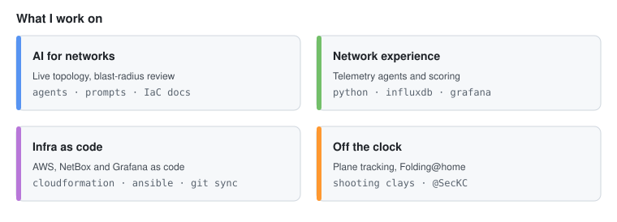
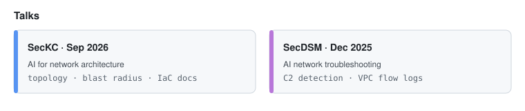

<!-- board:start -->
<picture>
  <source media="(max-width: 600px) and (prefers-color-scheme: dark)" srcset="assets/board-narrow-dark.svg?v=20261116">
  <source media="(max-width: 600px)" srcset="assets/board-narrow-light.svg?v=20261116">
  <source media="(prefers-color-scheme: dark)" srcset="assets/board-wide-dark.svg?v=20261116">
  
</picture>
<!-- board:end -->

---

- **SecKC, Sep 2026:** [AI for network architecture](https://github.com/skyefugate/2026-09-SecKC-AI-Talk)
- **SecDSM, Dec 2025:** [AI network troubleshooting](https://github.com/skyefugate/2025-12-SecDSM-AI-Talk)

## Toolbox

  

