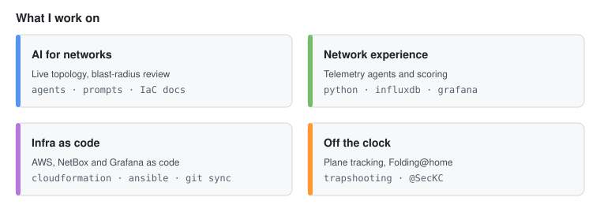
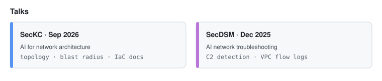
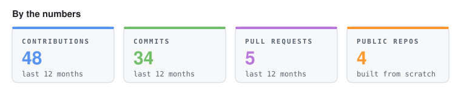
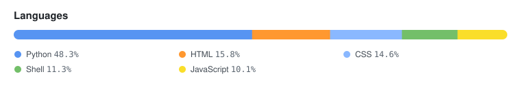
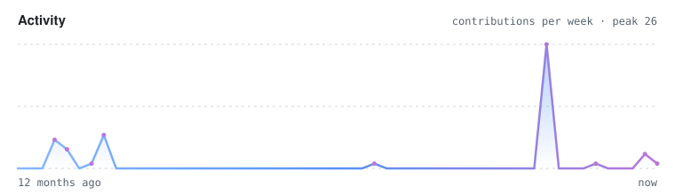

---

- **SecKC, Sep 2026:** [AI for network architecture](https://github.com/skyefugate/2026-09-SecKC-AI-Talk)
- **SecDSM, Dec 2025:** [AI network troubleshooting](https://github.com/skyefugate/2025-12-SecDSM-AI-Talk)

## Toolbox

  

